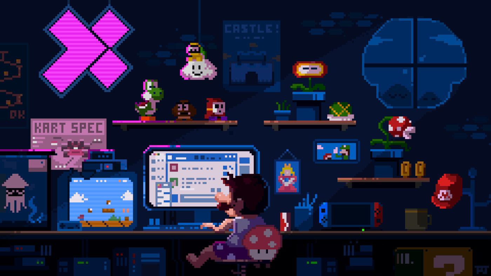

<h1>
  Hi, I’m
  
    Caleb
  
</h1>

I build things that connect ideas, people, and systems. I enjoy turning rough concepts into structured, usable products, and refining messy code into something fast, clean, and reliable.

My approach is simple: write code that’s easy to understand, easy to extend, and easy for others to contribute to.

### Core Stack

`React` · `Tailwind` · `JavaScript` · `TypeScript` · `Node.js` · `Express` · `MongoDB` · `Firebase` · `React Native` · `Expo` · `Three.js` · `Vite` · `Figma`

### What I Focus On

- Designing interfaces that feel intuitive and polished
- Building scalable backends and clean APIs
- Creating privacy-conscious tools and systems
- Automating repetitive workflows
- Contributing to open, remixable developer ecosystems

### Connect

- **Discord DM** → [discord.gg/calebephrem](https://discord.gg/calebephrem)  
  Reach out to collaborate, share ideas, or just talk through projects.

- **Dev Server** → [discord.gg/MuZFAeVHgp](https://discord.gg/MuZFAeVHgp)  
  A space to share work, get feedback, and build alongside other developers.

<table align="center">
  <tr>
    <td>
      I’m interested in building tools that reduce friction and help creators focus on what actually matters.
    </td>
    <td>
      
    </td>
  </tr>
</table>

  <picture>
    <source media="(prefers-color-scheme: dark)" srcset="https://github.com/Vaibhav2002/Vaibhav2002/blob/output/github-contribution-grid-snake-dark.svg" />
    <source media="(prefers-color-scheme: light)" srcset="https://github.com/Vaibhav2002/Vaibhav2002/blob/output/github-contribution-grid-snake.svg" />
    
  </picture>

